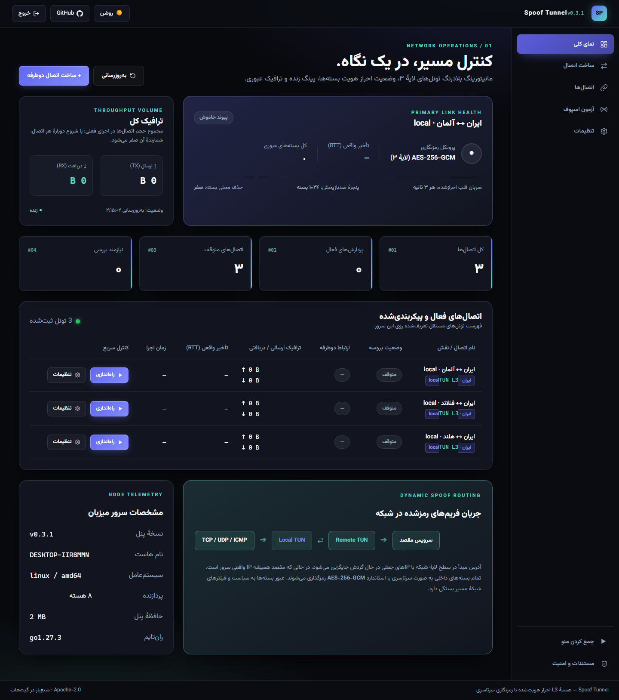
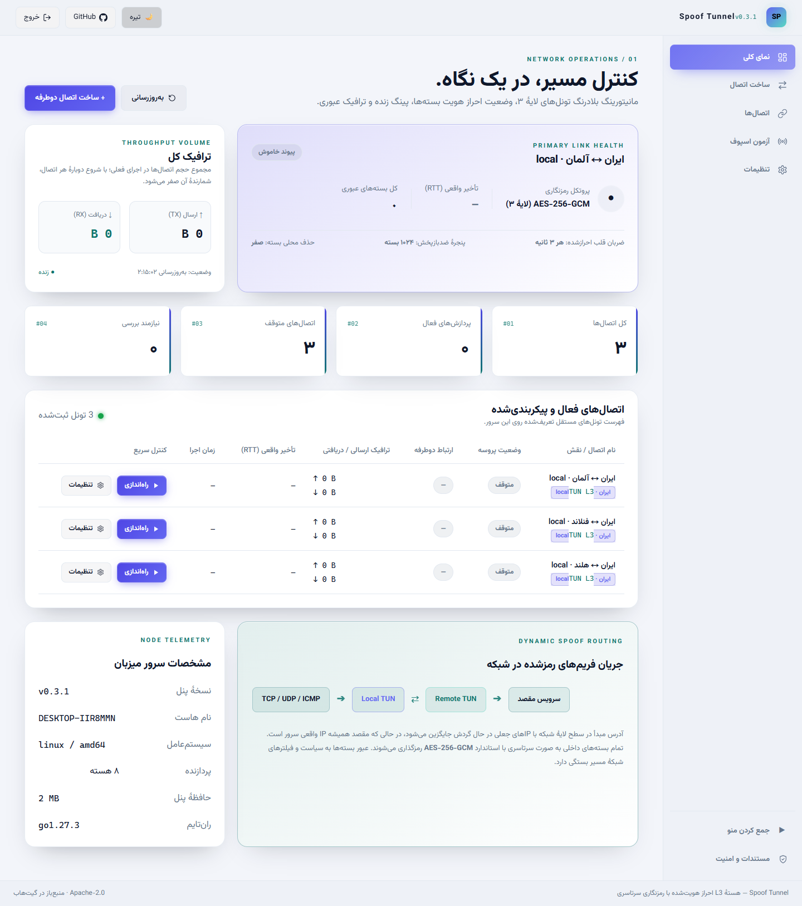
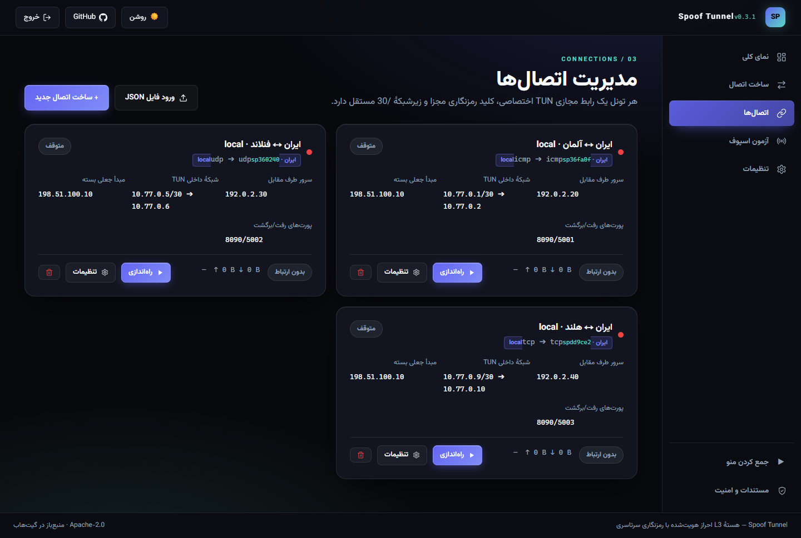
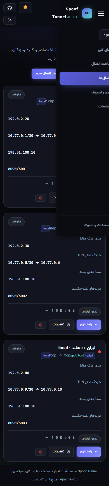

<div align="center">

# Spoof Tunnel

**Authenticated IPv4 TUN links. A Persian panel for every connection.**

[](https://github.com/emad1381/spoof-tunnel/releases/latest)
[](https://github.com/emad1381/spoof-tunnel/actions/workflows/panel-test.yml)
[](LICENSE)

**English** · [فارسی](README-fa.md) · [Releases](https://github.com/emad1381/spoof-tunnel/releases) · [Operations](docs/OPERATIONS.md) · [Testing](docs/TESTING.md)

</div>



*Actual v0.3.1 panel, served by the Go backend with a temporary SQLite database. The three configurations use documentation addresses and are stopped; this screenshot is not a live VPS performance claim.*

## What it does

`spoof-l3` creates an encrypted, point-to-point IPv4 TUN link between two Linux servers. Applications use its private addresses to exchange **TCP, UDP and ICMP**, independently of the outer packet carrier. The panel manages configuration, tunnel processes, authenticated peer status, forwarding and logs.

| Network engine | Management panel |
| --- | --- |
| ICMP, UDP, raw TCP, IP protocol 4 and protocol 253 | Persian RTL interface with locally served **Vazirmatn** |
| Independently selectable send/receive carriers | Complementary JSON configuration builder and import/export |
| AES-256-GCM, directional keys and replay protection | Dark/light themes and responsive navigation |
| Authenticated challenge/response heartbeat | Separate process state and authenticated peer state |
| Independent TUN interfaces and subnets | TCP entry-port forwarding to the selected peer |
| Reciprocal allowlists for rotating spoof sources | Live logs, traffic counters and SQLite persistence |

The current TUN engine and panel are Go binaries; they require no Rust or eBPF installation. The original UDP relay is retained separately in source.

## Install or update

Run as **root on each server**. Supported targets: Linux **amd64** and **arm64**, with systemd, iproute2, `/dev/net/tun`, `curl`, `tar` and `sha256sum`.

```sh
curl -fsSL https://raw.githubusercontent.com/emad1381/spoof-tunnel/main/install.sh | bash
```

The same command updates an existing installation to the **latest published Release**. It downloads the matching architecture, checks published checksums, installs the binary pair and restarts `spoof-panel`. Pushing source alone does not update this download; a Release with built assets must exist.

- First installation prints the administrator password and panel URL. Keep the password; it is not stored in recoverable form.
- Updates preserve the current database, password and configurations. Back up `/etc/spoof-panel` with the service stopped before upgrading.
- The panel and engine versions are stamped at build time. The header shows the running panel's version.
- The panel serves HTTP. Use an HTTPS reverse proxy or SSH forwarding for remote administration.

To explicitly install **v0.3.1**:

```sh
curl -fsSL https://raw.githubusercontent.com/emad1381/spoof-tunnel/v0.3.1/install.sh | SPOOF_RELEASE=v0.3.1 bash
```

Release packages are `spoof-tunnel-linux-amd64.tar.gz` and `spoof-tunnel-linux-arm64.tar.gz`, accompanied by archive `SHA256SUMS`. No Go, Node.js or Rust toolchain is needed on the VPS.

## Connect two servers

1. Open the panel on both servers. On one, choose **ساخت اتصال** (paired connection builder).
2. Enter each server's **real IPv4 address** and **spoofed source IPv4 address**. Real addresses are packet destinations; spoofed addresses are the expected outer sources.
3. Select the upload/download carriers, receive ports or ICMP identifiers, and an unused private `/30` subnet.
4. Choose which server this panel represents. Generate both configurations; only the selected end is saved locally.
5. Download the other end's JSON and import it in **اتصال‌ها** on the other server. **The file contains the PSK: keep it private.**
6. Start both ends. A running process alone is not proof of a connection; wait for an authenticated peer response.
7. Test the private link, then your service:

```sh
# Iran side, for the first example subnet
ping -c 3 10.77.0.2
```

A service on the foreign host must listen on its TUN address or an appropriate wildcard address. The panel does not change the default route or automatically create a public Internet gateway.

## One Iran server, multiple foreign peers

Create a **separate pair for every foreign server**. Each pair gets a distinct key and interface; use a non-overlapping subnet. The builder suggests a free subnet from configurations stored in that panel, and the backend rejects recorded subnet/interface conflicts.

| Link | Private subnet | Iran TUN IP | Foreign TUN IP | Suggested Iran receive port/ID |
| --- | --- | --- | --- | --- |
| Iran ↔ foreign A | `10.77.0.0/30` | `10.77.0.1` | `10.77.0.2` | `5001` |
| Iran ↔ foreign B | `10.77.0.4/30` | `10.77.0.5` | `10.77.0.6` | `5002` |
| Iran ↔ foreign C | `10.77.0.8/30` | `10.77.0.9` | `10.77.0.10` | `5003` |

**Receive ports do not automatically increment.** Choose separate values for clarity and reduced cross-processing. Shared carrier ports are supported with independent keys; the integration test also exercises identical foreign spoof sources. Using the same key/configuration for different links defeats this separation. The panel checks its saved configurations, not every route or interface on the host: avoid existing LAN/VPN ranges too.

### Which port is which?

| Setting | Meaning |
| --- | --- |
| Carrier receive port | Outer UDP/raw-TCP destination port, matched by the other end's send configuration |
| ICMP identifier | The carrier's numeric identifier; it is not a TCP service port |
| Protocol 4 / 253 | No TCP/UDP carrier port; these carry encrypted project frames directly |
| Public forward port | A TCP listener on the entry server for application clients |
| Target service port | A service on the selected foreign TUN IP |
| Panel port | Administration only; separate from tunnel and application ports |

For example, Iran entry `2443 → 10.77.0.2:443`, `3443 → 10.77.0.6:443` and `4443 → 10.77.0.10:443` serve three different peers. Target port `443` can repeat on different foreign IPs; enabled public entry ports on the same Iran host must be unique. Configure rules in the tunnel editor's **فوروارد معکوس** tab. Rules follow the tunnel lifecycle. The entry listener uses `0.0.0.0`; permit only intended clients in your firewall. Entry forwarding is **TCP only**; inner UDP still traverses the TUN.

<details>
<summary><strong>More panel views: light theme, connections and mobile</strong></summary>





</details>

## Diagnostics

| Symptom | Check first |
| --- | --- |
| Process fails to start | Instance logs, assigned local IP, TUN/raw-socket permissions and interface conflicts |
| Process runs, peer disconnected | Start the other end; match keys, real/spoof IPs, reciprocal carriers and receive values |
| Both ends run, no response | Provider source validation, firewall and reverse-path filtering |
| Peer responds, application fails | Private ping, service bind address, service port and explicit forwarding |
| Second link fails | Unique interface, non-overlapping subnet and correct exported peer configuration |

```sh
systemctl status spoof-panel
journalctl -u spoof-panel -n 100 --no-pager
/opt/spoof-panel/spoof-panel --version
/etc/spoof-panel/spoof-l3 --version
```

Lost administrator password? Reset it on the server; use 12–72 UTF-8 bytes. This invalidates previous login tokens:

```sh
/opt/spoof-panel/spoof-panel --setup --setup-pass 'YOUR_NEW_PASSWORD'
```

Rotating local spoof sources require the **same list in the other end's allowed-peer-source list**. Saving one server cannot update a separately managed server automatically.

## Build and verification

Build on Linux/WSL with the Go version specified in [go.mod](go.mod), Node.js 24 and npm:

```sh
SPOOF_VERSION=v0.3.1 bash scripts/build.sh
sudo bash dist/install.sh
```

The build exports the frontend, embeds it in `spoof-panel`, builds `spoof-l3` and packages both with the installer and documentation. GitHub Actions validates the source before creating release packages for both architectures.

Validation includes **25 ordered carrier combinations**, **five rotating-source cases**, delayed heartbeats above three seconds RTT, and **one Iran + three simultaneous foreign peers on all five carriers** with concurrent TCP/UDP probes and isolated stop/restart. **13 browser scenarios** cover panel behavior and locally served Persian fonts; Go race tests and real HTTP/SQLite tests cover the backend. Reproduce them with [Testing](docs/TESTING.md). See [Architecture](docs/ARCHITECTURE.md), [Operations](docs/OPERATIONS.md) and the [fix report](docs/FIXES-2026-11-01.md).

## Limits and attribution

Linux/IPv4 only. No automatic carrier fallback, FEC, custom retransmission/congestion control, IPv6 or full Internet gateway wizard. Raw TCP does not perform a normal TCP handshake. Protocol 4 is not wire-compatible with standard kernel IPIP. No standardized GRE, OSPF or IPsec support is claimed.

Namespace tests establish behavior in isolated Linux networks; they do not establish provider spoof acceptance, censorship resistance or sustained production throughput. Providers may block forged sources. Test your actual VPS pair. ARM64 is cross-compiled; runtime testing on ARM64 hardware and a real VPS systemd install remain separate deployment checks. The frame design has not undergone an independent cryptographic audit.

Derived from [ParsaKSH/spoof-tunnel](https://github.com/ParsaKSH/spoof-tunnel), with upstream history retained. Licensed under [Apache-2.0](LICENSE); see [NOTICE](NOTICE). This project is not PenguTunnel and is not wire-compatible with it.
