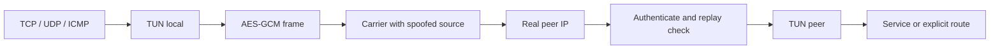

# Architecture and wire format

## Components

`spoof-panel` serves the embedded frontend and JSON API. SQLite stores administrators, tunnel definitions and a persistent JWT secret. The manager writes private JSON configurations and spawns `spoof-l3`. It waits for exit before restarting; enabled instances start with the panel.

`spoof-l3` exclusively creates a non-persistent Linux TUN, assigns an IPv4 CIDR/MTU and transports each IP packet inside an authenticated datagram. It uses a raw receiver bound to the real local address and an IPv4 raw sender. It filters the configured peer spoof source and carrier identifier/port. Closing the process releases the TUN; an existing TUN is not overwritten.

## Outer carriers

| Name | IPv4 protocol | Header |
|---|---:|---|
| icmp | 1 | Echo request; identifier equals peer receive port |
| tcp | 6 | TCP-shaped PSH/ACK; no TCP handshake/retransmission |
| udp | 17 | UDP datagram |
| ipip | 4 | Encrypted project frame, **not standard IPIP payload** |
| experimental | 253 | Encrypted project frame |

Transmit IPv4, ICMP and TCP/UDP checksums are computed. Port carriers use the peer receive port as destination. ICMP uses it as an identifier. Non-port carriers ignore identifiers. Real endpoints are distinct from spoof source/expected peer spoof. No GRE, OSPF or IPsec implementation is implied. The kernel may generate RST/ICMP responses to raw carriers; no global suppression is installed.

## Authenticated frame v1

Integers are big endian:

| Offset | Bytes | Field |
|---:|---:|---|
| 0 | 4 | `EML1` magic |
| 4 | 16 | Random sender session ID |
| 20 | 8 | Increasing packet sequence starting at 1 |
| 28 | 8 | Unix timestamp in seconds |
| 36 | variable | AES-256-GCM ciphertext and 16-byte tag |

The 36-byte header is AEAD additional authenticated data. Plaintext starts with one kind byte: `1` IP data, `2` challenge, `3` response.

Direction keys are HMAC-SHA256(PSK, `spoof-l3-v1/local-to-remote` or `spoof-l3-v1/remote-to-local`). The session key is HMAC-SHA256(direction key, raw session ID). Nonce is four zero bytes followed by the 64-bit sequence. A fresh 128-bit session ID is generated on process start. No forward secrecy is provided: protect and rotate the PSK.

Timestamps older than 120 seconds or more than 30 seconds in the future are rejected. A 1024-sequence replay window is tracked per authenticated session. State persists beyond the accepted timestamp's validity period. At most 64 live receive sessions are admitted; saturation fails closed. Direction separation rejects reflection. Authentication occurs before replay state changes.

Every three seconds, each end sends a fresh random 16-byte challenge. Only the matching authenticated response marks a peer reachable. After 15 seconds without a valid response the dashboard reports disconnected. This tests bidirectional engine reachability, **not application health or Internet access**. Counters measure accepted inner bytes, not delivery acknowledgments.

## Routing and limits

Only the connected TUN subnet is configured. No default route, global forwarding, NAT or host firewall rewrite occurs. Links need non-overlapping subnets and unique interfaces. Real endpoints must stay outside the TUN subnet. MTU is 576–1300; lower it for paths with more overhead.

Datagrams have no custom loss recovery. Inner TCP supplies TCP reliability. No FEC, custom congestion control, compression, IPv6, carrier negotiation or automatic failover is implemented. The frame design has not received an independent cryptographic audit.
